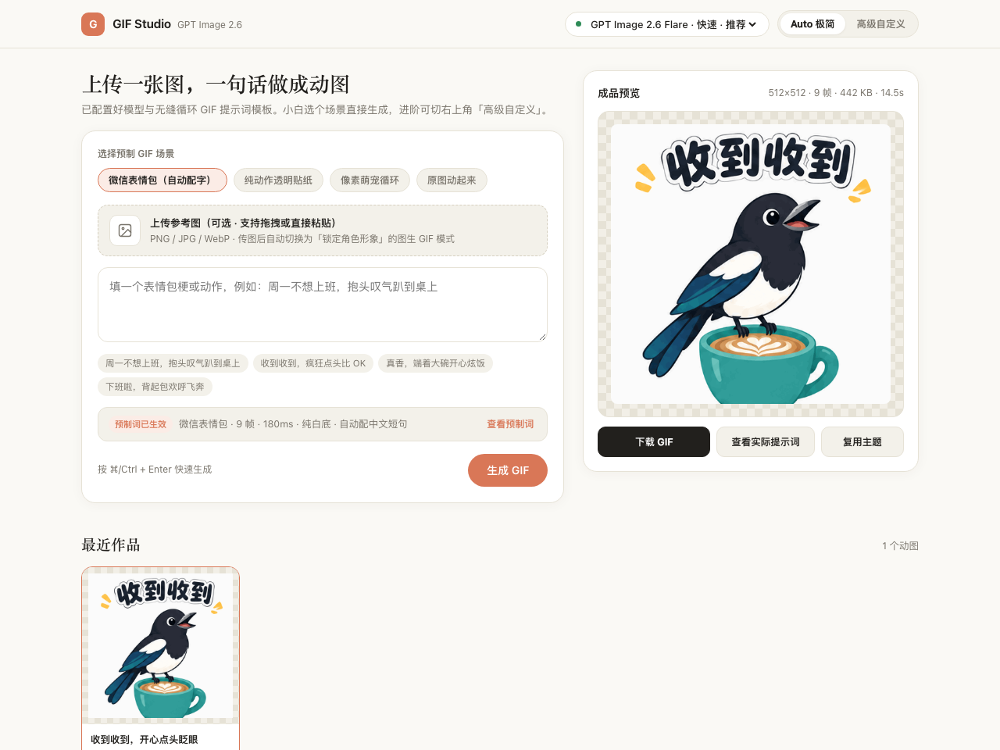
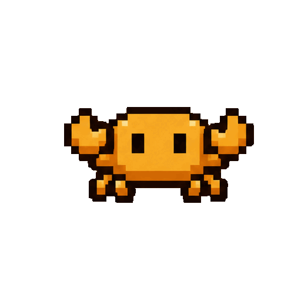
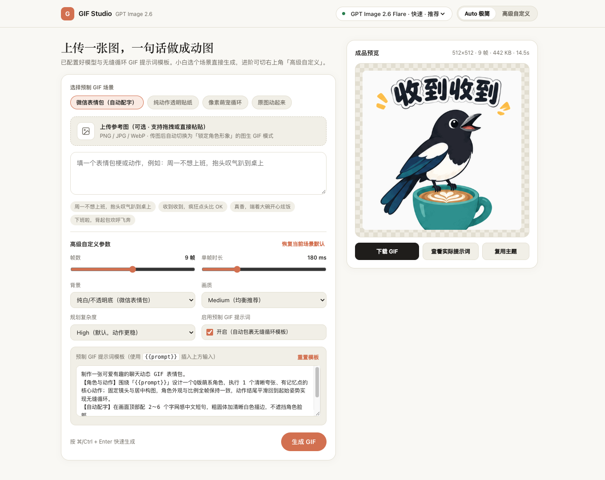

# GIF Studio

**上传一张图，一句话做成循环动图。**

面向普通用户的极简 AI GIF 表情包工作台，基于 OpenAI **GPT Image 2.6** 原生 GIF 生成与编辑能力构建。零构建步骤、仅 2 个依赖，30 秒即可本地启动。




---

## 实测动图效果（原生 GIF 直出）

> 以下均为 GIF Studio 调用 `gpt-image-2.6-flare` 一次直出的原始 GIF 成品，无后期拼接：

### 1. 图生 GIF：参考图一键变微信动态表情包

上传静态角色插画 + 选中「**微信表情包（自动配字）**」+ 输入一句 `收到收到，开心点头眨眼`，后台自动锁定角色形象并配好白描边中文短句（512×512 · 9 帧 × 180ms · 442 KB · 耗时 14.5s）：

| 上传参考原图 | 生成的循环动态表情包 |
| :---: | :---: |
|  |  |

### 2. 文生 GIF：透明底像素萌宠循环

不传参考图，选中「**像素萌宠循环**」模板直接文生透明背景动图，自带原生透明通道与无缝跳跃回环（512×512 · 9 帧 × 160ms · 170 KB · 耗时 14.0s）：

| 透明底像素小螃蟹（原生透明背景无缝循环） |
| :---: |
|  |

---

## 核心特性

- **开箱即用，前端零门槛**：API Key 与可用模型统一在服务端配置，打开网页只需「选场景 →（可选）传参考图 → 写一句话」即可出图。
- **Auto 极简 / 高级自定义双模式**：
  - **Auto 极简模式**（默认）：自动套用针对 GPT Image 2.6 调优的无缝循环提示词与最佳帧率参数，支持点击灵感词快速试用、展开查看底层预制词。
  - **高级自定义模式**：一键展开完整参数面板，自由调节帧数（2–16 帧）、单帧时长（60–500 ms）、背景（透明 / 纯白 / 自动）、画质（Low – Max）、规划复杂度，并支持现场编辑或关闭预制 GIF 提示词模板。
- **文生 GIF & 图生 GIF 自动切换**：支持点击上传、拖拽以及直接 `Cmd/Ctrl + V` 粘贴剪贴板图片（PNG / JPG / WebP，最大 20 MB）；上传参考图后自动切换为 `/v1/images/edits` 角色锁定模板。
- **内置作品画廊与透明预览**：右侧预览区自带透明棋盘格，支持一键下载 GIF、查看实际发送给模型的完整提示词、复用主题，以及自动保存本地历史作品。
- **极致轻量，配置外置**：无前端打包链路，仅依赖 `hono` 与 `@hono/node-server`；模型清单与预制提示词库均通过 JSON 文件配置。



---

## 内置 4 套预制 GIF 场景

每套场景均同时内置了「传参考图锁角色（`templateWithRef`）」与「纯文生 GIF（`templateTextOnly`）」两版提示词模板，自动根据是否上传参考图切换：

| 场景名称 | 默认参数 | 适用场景 |
| :--- | :--- | :--- |
| **微信表情包（自动配字）** | 9 帧 · 180ms · 纯白底 | 聊天斗图表情包，自动在顶部配 2～6 字粗圆体白描边中文短句 |
| **纯动作透明贴纸** | 9 帧 · 160ms · 透明底 | 无文字透明贴纸、聊天挂件与动态头像素材 |
| **像素萌宠循环** | 9 帧 · 160ms · 透明底 | 8-bit 复古像素风吉祥物、宠物与小图标循环动图 |
| **原图动起来** | 9 帧 · 200ms · 自动背景 | 保持原图画风、光影与构图不变，实现眨眼/微风/点头等自然微动 |

---

## 30 秒快速启动

### 环境要求

- **Node.js >= 22**（使用原生 `fetch` / `FormData`）
- 一个支持 GPT Image 2.6 的 OpenAI API Key（支持通过 `OPENAI_API_BASE_URL` 接入兼容中转服务）

### 启动步骤

```bash
# 1. 克隆仓库
git clone https://github.com/fengguanghuai/gif-studio.git
cd gif-studio

# 2. 安装依赖（仅 2 个轻量包）
npm install

# 3. 注入 Key 并启动
OPENAI_API_KEY=sk-你的Key npm start
```

启动后在浏览器访问 `http://127.0.0.1:4318/` 即可使用。

### 使用 `.env` 配置（推荐本地常驻）

复制 `.env.example` 为 `.env`（或 `.env.local`）并按需填写（进程环境变量优先级高于 `.env` 文件）：

```bash
cp .env.example .env
```

| 环境变量 | 必填 | 默认值 | 说明 |
| :--- | :---: | :--- | :--- |
| `OPENAI_API_KEY` | 是 | - | OpenAI 或兼容服务的 API Key |
| `OPENAI_API_BASE_URL` | 否 | `https://api.openai.com/v1` | 自定义 OpenAI 兼容接口地址 |
| `HOST` | 否 | `127.0.0.1` | 服务端监听地址（局域网共享可设为 `0.0.0.0`） |
| `PORT` | 否 | `4318` | 服务端监听端口 |

开发调试可使用热重启模式：

```bash
npm run dev
```

---

## 自定义模型与预制提示词

- **增删可用模型**：编辑 [`config/models.json`](config/models.json)，默认已配置 `gpt-image-2.6-flare`（快速推荐）和 `gpt-image-2.6-sunburst`（高精），重启服务即可生效。
- **扩展专属表情包模板**：编辑 [`config/presets.json`](config/presets.json)，使用 `{{prompt}}` 作为用户输入占位符，按现有结构新增一项即可出现在首页场景栏中。

---

## 项目结构

```text
gif-studio/
├── config/
│   ├── models.json         # 开放给前端的模型清单
│   └── presets.json        # 预制 GIF 场景与无缝循环提示词库
├── docs/
│   └── assets/             # README 界面截图与实测 GIF 演示素材
├── public/
│   ├── index.html          # 主界面
│   ├── styles.css          # 暖纸极简风样式
│   └── app.js              # 前端交互、粘贴上传、预览与历史画廊
├── server.mjs              # Hono 服务端、OpenAI Images API 代理与本地记录
├── .env.example            # 环境变量示例
└── package.json
```

---

## Roadmap

- [ ] 一键压缩适配微信表情包规格（自动裁剪与 `< 1MB` 体积优化）
- [ ] 支持多参考图融合与更多预制表情包场景
- [ ] 提供 Docker 一键部署镜像与可选访问口令保护

---

如果这个小工具对你有帮助，欢迎点个 **Star** 或提交 **Issue / PR**！
